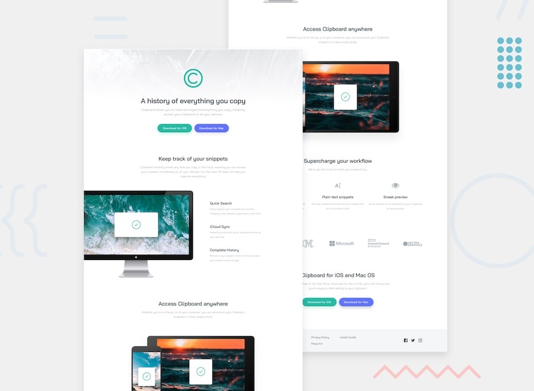

# Clipboard Landing Page

This is my solution to the [Clipboard Landing Page challenge on Frontend Mentor](https://www.frontendmentor.io/challenges/clipboard-landing-page-5cc9bccd6c4a1b00011a954).

The goal of this project was to build a responsive landing page based on the provided design, focusing on clean HTML structure, reusable styles, and adaptability across different screen sizes.

## Overview

### Features

- Responsive layout for desktop and mobile devices
- Multi-section landing page
- Flexible layouts using CSS Flexbox
- Reusable UI elements and consistent styling
- Download buttons with custom styles
- Product feature sections with images and icons
- Footer with navigation and social media links

### Links

- [GitHub Repository](https://github.com/tina2day/clipboard-landing-page-master)
- [GitHub Page](https://tina2day.github.io/clipboard-landing-page-master/)

## Built With

- Semantic HTML5
- CSS3
- CSS Flexbox
- Responsive Design
- Media Queries
- BEM Naming Convention

## What I Learned

Working on this project helped me improve my layout and styling skills while gaining more experience building a complete responsive landing page.

**Responsive Design**

I practiced adapting a multi-section layout to different screen sizes using media queries and flexible CSS layouts.

**CSS Flexbox**

I improved my understanding of Flexbox by arranging content sections, navigation elements, buttons, and groups of images.

**Reusable CSS Components**

I learned how to create consistent styles for repeated interface elements, such as buttons, headings, and content sections, to make the code easier to maintain.

**BEM Methodology**

I practiced organizing CSS classes using the Block Element Modifier (BEM) naming convention to keep styles structured and readable.

**Working with Images**

I gained experience positioning and scaling images while maintaining their proportions across different screen sizes.

**Attention to Detail**

I improved my ability to recreate designs from reference images, focusing on typography, spacing, alignment, colors, and visual consistency.

## Future Improvements

- Improve accessibility and keyboard navigation
- Replace placeholder links with functional destinations
- Further optimize images and loading performance
- Refine responsive behavior for additional screen sizes

## Author

- GitHub: [@tina2day](https://github.com/tina2day)
